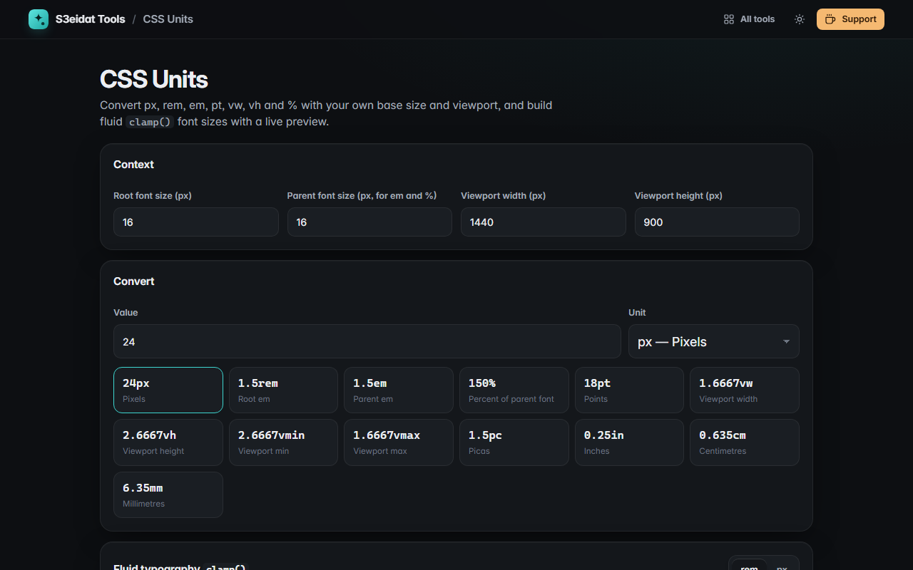

# CSS Units

> Convert px, rem, em, pt, vw, vh and % and generate fluid `clamp()` font sizes. Free, private, and it runs entirely in your browser.

### ▶ [Open CSS Units](https://s3eidat.github.io/css-units/)



## Features

- Set your own **root font size**, **parent font size** (for `em` and `%`) and **viewport** size
- Convert any value between `px`, `rem`, `em`, `%`, `pt`, `vw`, `vh`, `vmin`, `vmax`, `pc`, `in`, `cm` and `mm` at once; click a result to copy it
- Changing the unit keeps the same length, so you can type `1.5rem` and switch to see it in `pt`
- **Common sizes** table (8 to 96 px) in px, rem, em, pt, vw and %
- **Fluid typography**: smallest and largest size, viewport range → a ready `font-size: clamp(…)` line in rem or px
- **Live preview**: drag the viewport slider to see the exact size, on a chart and in sample text
- Settings are remembered on this device

Physical units use the CSS definition (1in = 96px), not your screen's real pixel density.

## Privacy

Everything is calculated on your device. There is no server, no account, no analytics.
The page ships with a strict Content-Security-Policy (`connect-src 'self'`), so the browser
itself blocks any attempt to send data anywhere.

## Run it yourself

It's plain HTML, CSS and JavaScript with no build step:

```bash
git clone https://github.com/s3eidat/css-units
cd css-units
python -m http.server 8000
```

Then open http://localhost:8000.

## Support

If this saved you time, **[buy me a coffee ☕](https://s3eidat.github.io/coffee/)**. It keeps every tool free.

---

Part of **[S3eidat Tools](https://s3eidat.github.io/)**: 100+ free, private tools that run in your browser. MIT licensed.
